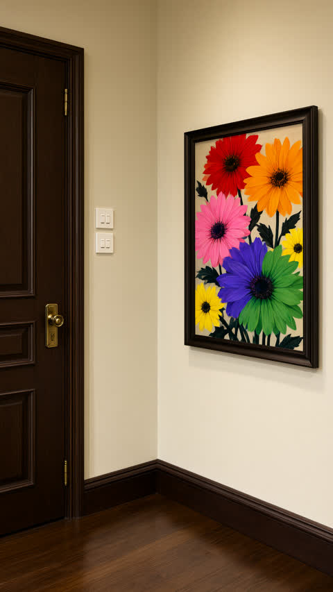
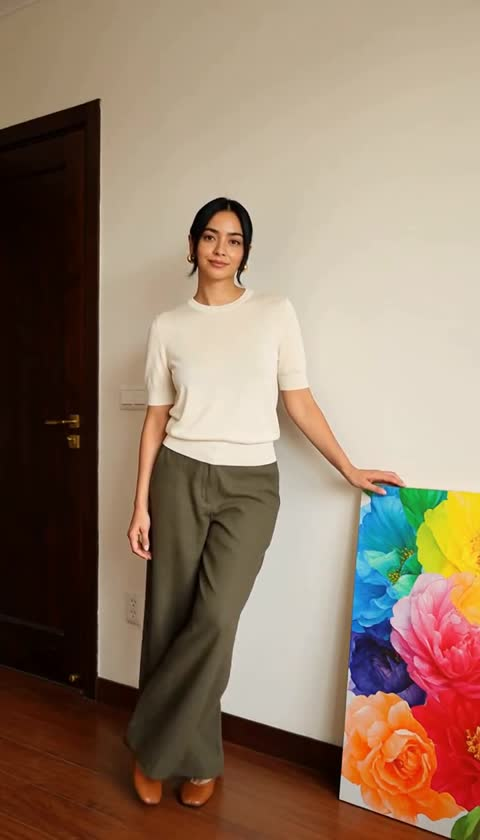

**English** · [简体中文版](README.zh-CN.md)

# StyleLoom

**A video-generation agent that learns from reference footage — then shoots something new in that style.**


Most video generators start from a prompt and hope. StyleLoom starts from a reference video you already trust: it cuts the footage into shots, has a vision model annotate every shot, distills that into a structured **style bible** (identity, wardrobe, art direction, camera grammar, rhythm, lighting, sound), and then drives MiniMax H3 to generate new shots from those constraints.

Each study also produces **portable skills** — "how to move the camera", "how to light a rainy street" — stored with evidence, and scored only by independent evidence and real human feedback. The model never grades its own homework. Skills can be exported to a read-only public library in `skills/`.

```
reference video ──ffmpeg──▶ shots / keyframes / reference clips
                              │
                              ▼
                   per-shot vision annotation
                              │
                              ▼
                   LLM distills a "style bible" + reusable style pack
                              │
                              ▼
                   extracts cross-project skills (evidence, feedback, confidence)
                              │
        ┌─────────────────────┼─────────────────────┐
        ▼                     ▼                     ▼
   stills / looks      shot plan + H3 prompt   reference clips
        └─────────────────────┼─────────────────────┘
                              ▼
                   icompify / MiniMax H3 renders the video
```

## Example

One 9.4-second vertical reference clip, studied once, then rendered twice. The take below is the **second render**: the character and location stills were fed back as Ref2VA references. The source footage is third-party and features a real person, so it is **not** redistributed here — what follows is the art direction the models derived from it, and the shot they produced.

| Learned art direction (AI still) | Generated shot (AI, Ref2VA take) |
| :---: | :---: |
|  |  |


[Open the full clip (MP4, 9.4 s, with audio)](docs/assets/example-generated.mp4) — 768×1344, one fixed camera, no cuts.

Full write-up: [reference stills + Ref2VA example](docs/examples/ref2va-with-stills-example.md).
Second run: a 120-second Xiaohongshu climbing video → 16-shot study → 9-second Ref2VA climbing shot ([write-up](docs/examples/xhs-climbing-example.md)).

## Quick start

Requirements: macOS or Linux (Windows untested), [Bun](https://bun.sh) 1.3+, `ffmpeg` / `ffprobe`. Xiaohongshu download additionally needs `yt-dlp`.

```bash
git clone https://github.com/zhuhong/styleloom.git
cd styleloom
bun install
mkdir -p data && cp settings.example.json data/settings.json
# edit data/settings.json — at minimum an LLM endpoint and an icompify key
bun start            # http://127.0.0.1:8787
```

`bun run chat` opens the terminal client. `bun run typecheck` is the sanity check.

Then fill in `data/settings.json` (or use the in-app **Settings** dialog):

| Field | Purpose |
| --- | --- |
| `llm.baseUrl` / `apiKey` / `model` | Any OpenAI-compatible text endpoint that supports tool calling |
| `llm.visionModel` | Model that accepts images; used for per-shot annotation |
| `video.provider` / `video.apiKey` | `icompify` (default, billed) or `local` (self-hosted GPU gateway) |
| `image.*` | Stills backend: `local` GPU, remote `openrouter` / `openai`, or empty to fall back to reference keyframes |
| `xhs.*` / `ffmpeg.*` / `learning.*` | Downloader, binary paths, slicing parameters |

Everything else — data layout, persistent service, LAN access, reverse proxy, backup, troubleshooting, self-hosted GPU setup — is in the **[deployment guide](docs/deploy.md)** and **[local GPU backend](docs/local-gpu.md)**.

## Using it

1. **Give it material** — a local video path, a Xiaohongshu note link, or just an idea.
2. **It studies** — slice → per-shot annotation → style bible → skill extraction, with progress streamed to the page. Review the result and ask for corrections.
3. **Stills** — `generate_still` for character / location references.
4. **Plan and preview** — `plan_shots`, then `build_shot_prompt`. Both free.
5. **Render** — `generate_shot(confirmed=true)` only after you have seen and approved the plan.
6. **Give feedback** — say "that shot is good / meh / bad"; skill confidence updates and compounds across projects.

## How it works

| Stage | Module | What it does |
| --- | --- | --- |
| Slicing | `learn/slice.ts` | Scene-cut detection, keyframes, samples, reference clips, audio |
| Annotation | `learn/annotate.ts` | One vision request per shot, strict JSON, resumable |
| Distillation | `learn/distill.ts` | Compress annotations into the style bible + reusable pack |
| Skills | `learn/skills.ts` | 3–8 candidate skills per study, merged by similarity, scored by evidence |
| Prompting | `generate/prompt.ts` | Picks T2VA / I2VA / FL2VA / L2VA / Ref2VA, then builds and validates the official H3 structure |
| Rendering | `providers/video/` | icompify or a self-hosted gateway |
| Assembly | `generate/stitch.ts` | Normalize every clip, then hard-cut or crossfade into a final asset |

The agent is a thin scheduler over these; each stage is an independent function you can run on its own. Details, data contracts and design rationale: **[ARCHITECTURE.md](ARCHITECTURE.md)**.

```
src/
├── server.ts      Bun HTTP + SSE + static hosting
├── agent/         conversation loop, system prompt, tool handlers
├── learn/         slice → annotate → distill → extract skills
├── generate/      reference decision, H3 prompt, single shot, stills, stitching
├── providers/     llm / image / video / download — protocol only
├── store/         projects, manifests, sessions, style packs, skills
└── util/          fs, ffmpeg, ssh, duration
web/               dependency-free HTML/CSS/JS front end
skills/            public read-only skill library
docs/              deploy, local GPU, skills, xhs, H3 prompting, examples
```

## Cost and safety guards

- `build_shot_prompt`, `plan_shots`, skill operations: **free**.
- `generate_shot`: **billed**, and refuses to run without `confirmed=true`. The agent must show the plan and prompt and get explicit consent first.
- API keys live only in `data/settings.json` (git-ignored, masked in API responses). A `pre-commit` hook rejects staged secrets.
- Reference footage is used for **style, camera work and art direction only**. Replicating a real person's identity is not the default.

## Status

Verified end to end:

- Slicing, study pipeline and skill extraction on two real references (a 12-second 3-shot sample and a 120-second 16-shot Xiaohongshu clip); 24 skills accumulated with evidence images and working lexical search.
- Real billed H3 renders: T2VA (9s, 9:16, with audio, ~141s) and Ref2VA from a character still + empty set still (9s, ~248s). VLM frame checks rated both "highly consistent" with only minor hand/framing artifacts.
- Agent tool chain through LiteLLM, server + SSE, settings API, project file access, skills API, front-end rendering.
- Front end: in-page media lightbox, chat Markdown, chat uploads bound to shots via `set_shot_references`.
- Timeline stitching: 4-shot project → 20.73s hard cut and 19.84s crossfade.
- Short shots: `plan_shots` accepts 1–15s; 4s→2s local trim verified with ffmpeg.
- Local GPU backends: stills via direct spawn or SSH (verified on an RTX 5090), and a self-hosted H3 video gateway (one real T2VA run, 361s including cold load).

Not yet verified: real I2VA / FL2VA renders (request shape mirrors the Toonflow provider; T2VA and Ref2VA are proven), and H3's direct 2/3s tier (the 4s+trim fallback is verified with a mocked provider).

## Limitations

- Shot detection is heuristic: no gradual transitions; long films degrade to equal segments.
- Annotation is serial — ~10–20 minutes for 40 shots — and skills are retrieved lexically, not by embedding.
- Assembly covers hard cuts and crossfades only; no subtitles, complex transitions, audio mixing or multi-track editing.
- Local GPU stills reload the model per image; local H3 is a single-worker gateway that cannot share the card with stills.
- Remote image APIs are text-to-image only; reference-image conditioning works on the local backend alone.
- Chat Markdown is a small subset (no math, footnotes or raw HTML); uploads are capped at 6 files, 20MB per image, 140MB per video.
- Xiaohongshu download depends on `yt-dlp` and your own browser session; private or deleted notes fail.

## Roadmap

- Parallel shot annotation with a resumable retry queue
- Vector skill retrieval plus feedback-driven rule rewriting
- Multi-track timeline editing, subtitles and audio mixing
- Reusing reference audio / dialogue-driven lip sync
- Rendered-output QA (first/last frame drift, identity drift, camera amplitude)

## Documentation

- [Deployment guide](docs/deploy.md) — dependencies, data layout, reverse proxy, backup, troubleshooting
- [Local GPU backend](docs/local-gpu.md) — direct / SSH stills, video gateway contract, limits
- [Architecture](ARCHITECTURE.md) — request lifecycle, data contracts, design rationale
- [Skill library](docs/skills.md) — lifecycle, matching, confidence
- [Xiaohongshu download](docs/xhs-download.md) — login state, failure modes
- [H3 prompting](docs/h3-prompting.md) — official prompt structure
- Examples: [style bible](docs/examples/style-bible-example.md) · [Ref2VA prompt](docs/examples/ref2va-prompt-example.txt) · [skill](docs/examples/skill-example.md) · [generated shot](docs/examples/generated-shot-example.md) · [Ref2VA with stills](docs/examples/ref2va-with-stills-example.md) · [climbing shot](docs/examples/xhs-climbing-example.md)

## Contributing

Issues and PRs welcome — see [CONTRIBUTING.md](CONTRIBUTING.md). Read [SECURITY.md](SECURITY.md) before reporting anything that looks like a credential leak.

## License

[MIT](LICENSE).

## Disclaimer

This tool is meant for learning *style, camera language and art direction*. Do not use it to impersonate real people, redistribute other creators' footage, or bypass paywalls and login walls. Xiaohongshu downloading relies on your own logged-in browser session and stores no cookies; complying with platform terms and copyright law is your responsibility. Generated content is your responsibility.
