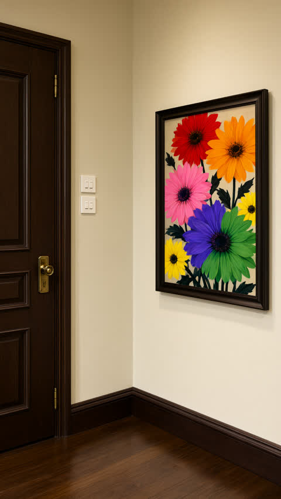
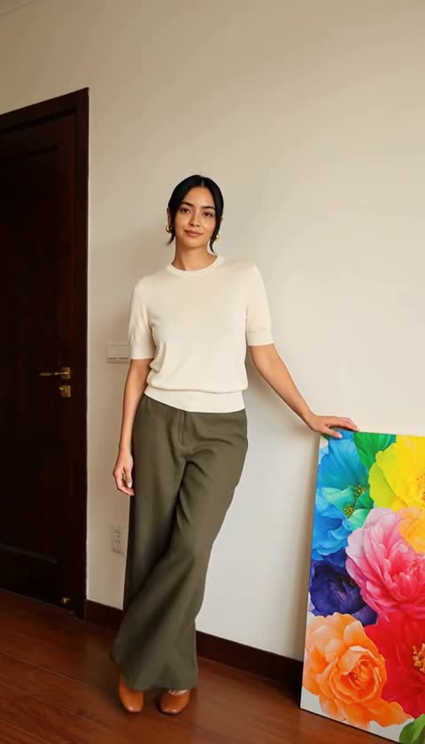
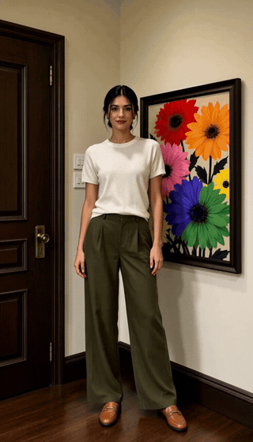

[English](README.md) · **简体中文版**

# StyleLoom

**一个会从参考片里学习的视频生成 Agent —— 学完再拍一个同样风格的新片。**


大多数视频生成工具从一句提示词开始，然后祈祷。StyleLoom 从一段你认可的参考片开始：切镜、逐帧拉片，把画面归纳成结构化的**风格圣经**（身份与服装、场景美术、运镜语法、节奏、灯光、声音），再用这些约束驱动 MiniMax H3 生成新镜头。

每次学习还会沉淀出**可迁移技能**——"这类镜头怎么运镜""雨夜街头怎么布光"——附带证据，置信度只由独立证据和真实反馈决定。久而久之，Agent 积累的是手艺，不只是提示词。

技能还能以**只读公开库**的形式发布：仓库自带 `skills/` 目录存放可分享的知识（不含证据图、反馈与置信度），`export_skills` 能把本机可信技能导出为可分享条目。运行时 `search_skills` / `read_skill` 同时读取本机 `data/skills/` 与公开 `skills/`，id 冲突时本机覆盖。

```
参考视频 ──ffmpeg──▶ 镜头切片 / 关键帧 / 参考片段
                        │
                        ▼
             视觉模型逐镜标注
        （景别/角度/运镜/灯光/主体/动作/声音）
                        │
                        ▼
             语言模型归纳「风格圣经」+ 可复用风格包
                        │
                        ▼
             抽取跨项目技能（证据/反馈/置信度持续累积）
                        │
      ┌─────────────────┼─────────────────┐
      ▼                 ▼                 ▼
 定妆照/场景照    分镜与 H3 提示词    参考片段（运镜/节奏）
      └─────────────────┼─────────────────┘
                        ▼
              icompify / MiniMax H3 生成视频
```

## 示例

一段 9.4 秒的竖屏参考片，学习一次后生成两版。下面这版是**第二次生成**：把人物定妆照与空场景照作为 Ref2VA 参考图回灌。原片属于第三方且含真人，**不随仓库分发**；展示的是模型从中学到的美术方向，以及据此生成的镜头。

| 学到的美术方向（AI 静帧） | 生成的镜头（AI，Ref2VA 版） |
| :---: | :---: |
|  |  |



[打开完整片段（MP4，9.4 秒，含音轨）](docs/assets/example-generated.mp4) —— 768×1344，固定机位一镜到底。

完整记录：[参考图 + Ref2VA 示例](docs/examples/ref2va-with-stills-example.md)。

第二次实战：120 秒小红书攀岩视频 → 16 镜学习 → 9 秒 Ref2VA 攀岩镜头。记录：[攀岩同款示例](docs/examples/xhs-climbing-example.md)。

## 为什么不是又一个视频 Agent

- **结构化胜过相似度。** 一个镜头需要的是可执行约束：身份锚点、服装、场景布局、运镜类型与幅度速度、光线方向。这些字段直接进 H3 提示词，同时人也能读懂、能改。
- **技能要有证据，不靠感觉。** 技能置信度只来自独立项目证据与真实反馈，模型不自评。
- **费用边界明确。** 写提示词免费；出片必须在你看过分镜和提示词之后显式 `confirmed=true`。

## 快速开始

环境：macOS / Linux（Windows 未验证）、[Bun](https://bun.sh) 1.3+、本机 `ffmpeg` / `ffprobe`。小红书下载另需 `yt-dlp`（`brew install yt-dlp`）。

```bash
git clone https://github.com/zhuhong/styleloom.git
cd styleloom
bun install
mkdir -p data && cp settings.example.json data/settings.json
# 编辑 data/settings.json —— 至少填 LLM 地址和 icompify Key
bun start
# 打开 http://127.0.0.1:8787
```

想在终端里聊：`bun run chat`。类型检查：`bun run typecheck`。

### 配置

全部在 `data/settings.json`（或在网页「设置」里改）。`data/` 已被 git 忽略；接口返回设置时密钥打码，前端保存时以 `********` 占位符保留原值。

| 字段 | 说明 |
| --- | --- |
| `llm.baseUrl` / `apiKey` / `model` | 任意 OpenAI 兼容文本接口（默认本机 LiteLLM `http://localhost:4000/v1`） |
| `llm.visionModel` | 支持图片输入的模型（默认 `deepseek-v4.1-flash`），Gemini 等也可 |
| `video.baseUrl` / `apiKey` | icompify 开放平台，默认 `https://api.icompify.com` |
| `video.model` / `referenceModel` | `minimax-h3-fl2va`（文生 / 首尾帧）、`minimax-h3-ref2va`（参考图 / 参考视频） |
| `image.*` | 定妆照后端。`image.api=local` 走局域网 **RTX 5090**（Qwen-Image-2.1-Turbo，SSH 调用，免费）；`openrouter` / `openai` 走远程图片接口；`auto` 优先 5090、不可达再回退。留空则回退参考帧。见 [docs/5090-image.md](docs/5090-image.md) |
| `image.local.*` | `host`、`pythonBin`、`script`、`workdir`、`shortEdge`（768）、`steps`（8）、`vram`（`offload`） |
| `xhs.*` | `ytDlpPath`、`cookiesFromBrowser`（chrome / safari / firefox / edge / 留空）、referer、UA、超时 |
| `ffmpeg.*` | 二进制路径，默认 `ffmpeg` / `ffprobe` |
| `learning.*` | 切镜阈值、最短镜头、最多镜头数、每镜采样帧数、是否保留片段 |

## 怎么用

1. **给素材** —— 本地视频路径、小红书笔记链接（建议带 `xsec_token` 的完整 URL），或直接说想法。
   例：*"学习 `/path/reference.mp4` 的运镜和灯光，做一个 8 秒的雨夜街头对话镜头。"*
2. **Agent 学习** —— 小红书链接先 `download_xhs_video` 下载，再 `study_reference_video` 切片、标注、归纳、抽技能，进度实时推送到页面。
3. **确认学习结果** —— Agent 用中文汇报角色、场景、运镜、节奏；不满意就让它 `update_style_bible`。
4. **出定妆照 / 场景照** —— `generate_still`。没配图片模型时会复制参考关键帧，并明确告知。
5. **写分镜** —— `plan_shots`，每镜 1–15 秒整数（H3 安全下限 4 秒，短镜头走裁剪或实验直发）；想让某镜继承参考片运镜就设 `referenceShotIds`。
6. **预览提示词** —— `build_shot_prompt`，不花钱。会按素材自动选择 T2VA / I2VA / FL2VA / L2VA / Ref2VA。
7. **确认后生成** —— `generate_shot(confirmed=true)`，必须先看过并同意分镜与提示词。
8. **回看与反馈** —— 说某个镜头"好 / 一般 / 差"，Agent 用 `record_skill_outcome` 更新技能置信度。
9. **持续积累** —— 第二部参考片命中同一技能会合并证据；3 个独立项目证据或 1 次好评即升为 `active`。

## 工作原理

### 1. 切片 `src/learn/slice.ts`

`ffprobe` 读取时长、尺寸、帧率、音轨。切点来自 `ffmpeg -vf "select='gt(scene,0.32)',metadata=print:file=-"`；距上一刀小于 `minShotSeconds` 的丢弃；超过 `maxShots` 退化为等分切片（代码里有 `ACT:` 注释）。每镜产出：中点 `frame.jpg`（960 宽）、15/50/85% 三张采样（640 宽，供视觉模型比较运动）、重编码 `clip.mp4`（可当 Ref2VA 参考），以及整片 `audio.m4a`。写入 `learning/slice.json`。

### 2. 逐镜标注 `src/learn/annotate.ts`

每个镜头一次视觉请求，多图按时间顺序，要求严格 JSON：景别、角度、运镜、灯光、调色、构图、主体、服装、场景、动作、表情、对白、声音、描述、`h3ShotBlock`、风格标签。只有单帧时强制 `movement = unable to determine`，避免模型编造运镜。每镜成功即落盘，失败可断点续跑（`force` 可重标）。

### 3. 归纳 `src/learn/distill.ts`

把逐镜标注压成观察记录，文本模型输出 `style`（含统一 `stylePrefix`）、`characters`、`locations`、`cameraGrammar`、`rhythm`、`prompting`、`sound`。引用的镜头 id 必须存在于 manifest；角色/场景的 `refImages` 由 id 映射到关键帧，映射失败按文本弱匹配兜底。归纳失败回退规则版（频率统计），保证切片成果不浪费，原因写入 `learning.warning`。输出 `learning/styleBible.json` / `.md`，并存一份可复用风格包到 `data/library/packs/`。

### 4. 技能抽取 `src/learn/skills.ts`

把"这部片是什么样"变成"以后遇到类似镜头怎么做"。一次文本调用产出 3–8 条候选技能（kind、中文规则、英文 prompt fragment、适用/避免条件、证据镜头）。与既有技能做相似度匹配（标签 Jaccard + 文本 Jaccard + fragment Jaccard，阈值 0.52），命中则合并证据、版本 +1，否则新建 `candidate`。证据关键帧复制进 `data/skills/<id>/evidence/`，项目删除后技能仍可读。抽取失败只写 warning，不影响学习结果。

### 技能生命周期

```
抽取 ─▶ candidate（置信度约 0.32）
   ├─ 新参考片命中 → 证据 +1，置信度上升
   ├─ 生成后好评 → active
   ├─ 3 个独立项目证据 → active
   ├─ 差评 ≥2 且多于正面 → deprecated
   └─ merge_skills → 源技能 deprecated + mergedInto
```

置信度 = 基础 0.32 + 证据加成（≤0.25）+ 反馈加成（≤0.40）+ 使用加成（≤0.08）。模型自评不进入置信度。

规划前 Agent 会 `search_skills` 再 `read_skill`，把 prompt fragment 落进分镜；`plan_shots` / `generate_shot` 记录 `skillIds`，生成后 `record_skill_outcome` 回写反馈。

### 生成模式

`prepareReferences` 按优先级决定：

| 条件 | 模式 | icompify task / 模型 |
| --- | --- | --- |
| 显式 `firstFrame` + `lastFrame` | FL2VA | `fl2va` / `minimax-h3-fl2va` |
| 显式 `firstFrame` | I2VA | `fl2va` / `minimax-h3-fl2va` |
| 有参考片段 `referenceShotIds` | Ref2VA | `ref2va` / `minimax-h3-ref2va` |
| 只有角色/场景参考图 | I2VA | `fl2va` / `minimax-h3-fl2va` |
| 都没有 | T2VA | `t2va` / `minimax-h3-fl2va` |

参考顺序：角色（`<Subject N>` / `<Picture N>`）→ 场景（`<Picture N>`）→ 参考片段（`<Video N>`）。平台限制：4 图 / 3 视频 / 4–15 秒 / 单素材 ≤140MB；工具接受 1–15 秒，短镜头默认 4 秒生成后裁剪。

提示词由"提示词导演"模型按官方结构撰写；字段缺失、顺序不对或超 7000 字符时，回退到确定性骨架（结构天然合法）。`validatePrompt` 校验字段与顺序、对齐句逐字匹配、Ref2VA 六段结构、长度上限。

## 费用与安全

- `build_shot_prompt`、`plan_shots`、技能类操作：**免费**。
- `generate_shot`：**计费**，且没有 `confirmed=true` 一律拒绝执行；Agent 必须先展示分镜与提示词并取得明确同意。
- `study_reference_video`、`extract_skills` 会调用付费模型，进度实时可见，便于控成本。
- API Key 只存在 `data/settings.json`（git 忽略、接口打码）。仓库自带 `pre-commit` 钩子拦截密钥入库。
- 参考片只用于**借风格、运镜、美术**，不默认复刻真人身份；你明确要求复刻时，版权与肖像权由你负责。

## 项目结构

```
src/
├── server.ts             Bun HTTP + SSE + 静态托管
├── cli.ts                终端对话
├── config.ts             settings 读写（打码、密钥保留）
├── types.ts              领域模型
├── agent/                对话循环、系统提示词、23 个工具
├── learn/                切片 → 标注 → 归纳 → 抽技能 → 编排
├── generate/             参考决策、H3 提示词、单镜生成、定妆照
├── providers/            llm / image（含 5090 SSH 后端）/ download(xhs) / video(icompify)，只做协议转换
├── store/                项目、manifest、会话、风格包、技能
└── util/                 文件、ffmpeg、ssh 与时长原语
web/                      无构建步骤的原生前端
skills/                   公开只读技能库（仅知识，不含证据图）
docs/                     技能、小红书下载、5090 出图、H3 提示词、示例
```

磁盘上的数据（`data/`，已被 git 忽略）：

```
data/
├── settings.json                     # 密钥，永远不要提交
├── cache/xhs/<noteId>-<ts>/          # yt-dlp 原始下载
├── library/packs/<projectId>.json    # 可复用风格包
├── skills/<id>/{skill.json,SKILL.md,evidence/}
└── projects/<projectId>/
    ├── project.json  session.json
    ├── learning/{slice.json,styleBible.json,.md,audio.m4a,shots/s01/...}
    └── assets/{sources,stills,videos,uploads}/
```

`Project` 是唯一状态源：`brief`、`learning`、`styleBible`、`plan[]`、`assets[]`。分镜只存 `referenceShotIds`，不复制片段。

## 当前状态

已端到端验证：

- 本地切片：12 秒 3 镜样本，切点检测、关键帧、采样、片段、音轨均正常。
- 学习链路：`deepseek-v4.1-flash` 3 镜约 4 分钟，角色 / 场景 / 运镜 / 灯光 / 节奏输出可用。
- 技能库：三次学习累计 24 条技能，写入 `skill.json` + `SKILL.md` + 证据图；真实好评使 candidate → active；中文词法检索命中。
- Agent 工具链：经 LiteLLM 真实跑通 `read_learning_shots → update_brief → plan_shots → build_shot_prompt`，产出 6309 字符合法 Ref2VA 提示词。
- 小红书下载：真实笔记（9.45 秒、720×1280、含音轨），短链 / URL / 分享文案解析与失败分支均验证。
- 服务端、SSE、设置接口、项目文件访问、技能 API 与页面渲染。
- 前端素材灯箱：关键帧、定妆照、技能证据与成片在页内弹窗查看（图片 / 视频 / 音频），支持遮罩与 ESC 关闭，不再跳新页面。
- 对话 Markdown：助手消息在页内渲染标题、列表、表格、围栏代码块与安全链接；原始 HTML 会被转义，危险 URL 会被拒绝。
- 聊天上传：图片/视频可附加或拖入输入框，保存到 `assets/uploads/`，随会话历史保留；用 `set_shot_references` 绑定到分镜（图片走 Ref2VA，首/尾帧走 I2VA/FL2VA）。
- 5090 本地出图后端：`generate_still` 通过 SSH 调 `qwen_image_gen2.py`，先用 scp 上传最多 3 张参考帧，再把 PNG 拉回，并在素材上记录 `backend/model/references`。已用假的 `ssh`/`scp` 验证整条链路（参数拼装、单引号转义、远端临时目录清理）；真实 5090 出图待验证——当前 `192.168.0.121:22` 拒绝连接，无法实测。
- 一次真实计费 H3 T2VA 出片：9 秒、9:16、768×1344、含音轨，排队+推理约 141 秒；VLM 三帧质检判定"高度符合"，仅有轻微机位漂移与手指/画框轻微融合。
- 一次真实计费 H3 Ref2VA 出片：人物定妆照 + 空场景照两张参考图，9 秒、9:16、768×1344、含音轨，约 248 秒；VLM 质检判定身份/房间/构图"高度符合"，无裁切/漂移，仅手部与墙面开关面板有轻微偏差。
- 第二条参考片（120 秒小红书攀岩视频，16 镜）：抽取 8 条技能；9 秒 Ref2VA 攀岩镜头约 248 秒出片，VLM 判定动作、身份、馆内布局"高度符合"；5 条运镜/灯光/色彩技能升为 active（0.80）。
- 整片拼接：`stitch_shots` 先统一转码，再硬切/叠化输出 H.264/AAC 成片；已在「名画上街」4 镜项目验证（硬切 20.73 秒，0.3 秒叠化 19.84 秒）。
- 短镜头：`plan_shots` 接受 1–15 秒；4 秒→2 秒本地裁剪已用 ffmpeg 验证；H3 的 2/3 秒直发档位通过 `experimentalDuration=true` 暴露，但尚未做真实计费测试。

尚未验证：I2VA / FL2VA 的真实出片（请求格式与 Toonflow provider 一致，T2VA、Ref2VA 已跑通）；H3 的 2/3 秒直发档位（本地 4 秒+裁剪回退已用 mock provider 验证）；本项目经 5090 的真实 Qwen 出图（SSH 链路已验证，GPU 未实测）。

## 已知限制

- 切点检测是启发式：不识别渐变转场；超过 `learning.maxShots` 的长片退化为等分切片。
- 标注串行：40 镜约 10–20 分钟；失败可从已完成镜头续跑。
- 技能检索是词法匹配，不是向量检索。
- 已支持基础整片拼接（硬切 / 叠化），但字幕、复杂转场、混音与多轨编辑未实现。
- H3 的 2/3 秒短档位属于实验能力；安全默认是 4 秒生成后本地裁剪。
- 远程图片接口只支持文生图；参考图条件只有 5090 后端支持（通过 `--ref` 传最多 3 张）。
- 5090 每张定妆照都是独立进程，约 31GB 的 pipeline 每次都要重新加载（约 20–60 秒/张）；批量出图请直接在 5090 侧用 `--batch` 或 `diffsynthGateway.py`。
- 套用风格包只复制被引用的图片与片段，不复制原项目分镜。
- 对话 Markdown 是轻量实现：不支持数学公式、脚注与原始 HTML；原始 HTML 会按文本显示。
- 聊天上传单次最多 6 个文件，图片 ≤20MB、视频 ≤140MB；不支持 SVG。
- 小红书下载依赖 `yt-dlp` 与你自己的浏览器登录态；私密、已删除、地区限制的笔记会失败。Safari 读 Cookie 需给终端「完全磁盘访问权限」。

## 路线图

- 镜头级并行标注 + 断点重试队列
- 技能向量检索 + 依据反馈自动改写规则
- 多轨时间线、字幕与混音
- 复用参考音频 / 对白驱动口型
- 图片参考图编辑，提升角色一致性
- 风格包浏览、对比与增量合并
- 成片质检（首尾帧偏差、身份漂移、运镜幅度）

## 文档

- [技能库](docs/skills.md) —— 生命周期、匹配、置信度
- [小红书下载](docs/xhs-download.md) —— 登录态与失败分支
- [H3 提示词](docs/h3-prompting.md) —— 官方提示词结构
- [5090 本地出图](docs/5090-image.md) —— SSH 配置、设置项与自检
- [架构说明](ARCHITECTURE.md) —— 请求生命周期与设计取舍
- 示例：[风格圣经](docs/examples/style-bible-example.md) · [Ref2VA 提示词](docs/examples/ref2va-prompt-example.txt) · [技能](docs/examples/skill-example.md) · [真实出片](docs/examples/generated-shot-example.md) · [Ref2VA 定妆照版](docs/examples/ref2va-with-stills-example.md) · [攀岩同款](docs/examples/xhs-climbing-example.md)

## 参与贡献

欢迎 issue 和 PR，动手前先看 [CONTRIBUTING.md](CONTRIBUTING.md)。发现疑似密钥泄漏请先读 [SECURITY.md](SECURITY.md)。

## 许可证

[MIT](LICENSE)。

## 免责声明

本项目用于学习**风格、镜头语言与美术方向**。请勿用它冒充真实人物、转载他人素材，或绕过付费墙与登录墙。小红书下载依赖你自己的已登录浏览器会话，不保存 Cookie；请自行遵守平台条款与当地著作权法。生成内容的责任由使用者承担。
