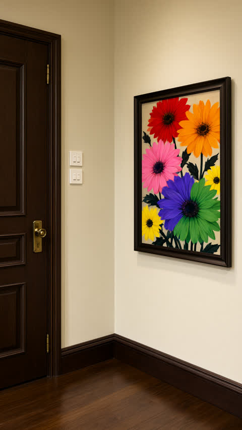
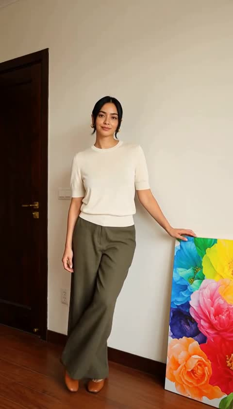
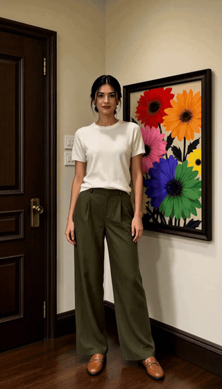

[English](README.md) · **简体中文版**

# StyleLoom

**一个会从参考片里学习的视频生成 Agent —— 学完再拍一个同样风格的新片。**


大多数视频生成工具从一句提示词开始，然后祈祷。StyleLoom 从一段你认可的参考片开始：切镜、逐镜拉片，把画面归纳成结构化的**风格圣经**（身份与服装、场景美术、运镜语法、节奏、灯光、声音），再用这些约束驱动 MiniMax H3 生成新镜头。

每次学习还会沉淀出**可迁移技能**——"这类镜头怎么运镜""雨夜街头怎么布光"——附带证据，置信度只由独立证据和真实反馈决定，模型不自评。技能可导出到仓库自带的只读公开库 `skills/`。

```
参考视频 ──ffmpeg──▶ 镜头切片 / 关键帧 / 参考片段
                        │
                        ▼
                  视觉模型逐镜标注
                        │
                        ▼
             语言模型归纳「风格圣经」+ 可复用风格包
                        │
                        ▼
             抽取跨项目技能（证据/反馈/置信度持续累积）
                        │
      ┌─────────────────┼─────────────────┐
      ▼                 ▼                 ▼
 定妆照/场景照    分镜与 H3 提示词    参考片段（运镜/节奏）
      └─────────────────┼─────────────────┘
                        ▼
              icompify / MiniMax H3 生成视频
```

## 示例

一段 9.4 秒的竖屏参考片，学习一次后生成两版。下面这版是**第二次生成**：把人物定妆照与空场景照作为 Ref2VA 参考图回灌。原片属于第三方且含真人，**不随仓库分发**；展示的是模型从中学到的美术方向，以及据此生成的镜头。

| 学到的美术方向（AI 静帧） | 生成的镜头（AI，Ref2VA 版） |
| :---: | :---: |
|  |  |



[打开完整片段（MP4，9.4 秒，含音轨）](docs/assets/example-generated.mp4) —— 768×1344，单机位无剪辑。

完整说明：[定妆照 + Ref2VA 示例](docs/examples/ref2va-with-stills-example.md)。
第二次：120 秒小红书攀岩视频 → 16 镜学习 → 9 秒 Ref2VA 攀岩镜头（[说明](docs/examples/xhs-climbing-example.md)）。

## 快速开始

环境：macOS / Linux（Windows 未验证）、[Bun](https://bun.sh) 1.3+、`ffmpeg` / `ffprobe`。小红书下载另需 `yt-dlp`。

```bash
git clone https://github.com/zhuhong/styleloom.git
cd styleloom
bun install
bun run build:web
mkdir -p data && cp settings.example.json data/settings.json
# 编辑 data/settings.json —— 至少填 LLM 地址和 icompify Key
bun start            # http://127.0.0.1:8787
```

前端是 Preact + Vite（`web/`）。改 UI 时：一个终端 `bun start`，另一个 `bun run dev:web`（Vite `:5173`，代理 `/api`）。`bun run chat` 打开终端客户端，`bun run typecheck` 做类型检查。

然后在 `data/settings.json`（或网页「设置」）里填：

| 字段 | 说明 |
| --- | --- |
| `llm.baseUrl` / `apiKey` / `model` | 任意支持 tool calling 的 OpenAI 兼容文本接口 |
| `llm.visionModel` | 支持图片输入的模型，逐镜拉片用 |
| `video.provider` / `video.apiKey` | `icompify`（默认，计费）或 `local`（自建 GPU 网关） |
| `image.*` | 定妆照后端：`icompify` 云端图片模型（默认 `qwen-image-2.1`）、本地 GPU，或 `openrouter` / `openai`；没 Key 时回退参考帧 |
| `xhs.*` / `ffmpeg.*` / `learning.*` | 下载器、二进制路径、切片参数 |

其余内容——数据目录、常驻服务、局域网访问、反向代理、备份、排错、自建 GPU——见 **[部署配置指南](docs/deploy.md)** 与 **[本地 GPU 后端](docs/local-gpu.md)**。

## 怎么用

1. **给素材** —— 本地视频路径、小红书笔记链接，或直接说想法。
2. **它开始学习** —— 切片 → 逐镜标注 → 风格圣经 → 抽技能，进度实时推送到页面。看完结果可以要求修正。
3. **出定妆照 / 场景照** —— `generate_still`。
4. **写分镜并预览** —— `plan_shots`，再 `build_shot_prompt`。两步都免费。
5. **生成** —— `generate_shot(confirmed=true)`，必须先看过并同意分镜与提示词。渲染是**后台任务**：对话立刻返回，进度实时显示在右侧「渲染」Tab，关掉页面也不会中断。
6. **给反馈** —— 说某个镜头"好 / 一般 / 差"，技能置信度会更新并跨项目累积。

## 工作原理

| 阶段 | 模块 | 作用 |
| --- | --- | --- |
| 切片 | `learn/slice.ts` | 场景切点检测、关键帧、采样、参考片段、音轨 |
| 逐镜标注 | `learn/annotate.ts` | 每镜一次视觉请求，严格 JSON，可断点续跑 |
| 归纳 | `learn/distill.ts` | 把标注压成风格圣经 + 可复用风格包 |
| 技能抽取 | `learn/skills.ts`、`learn/stillSkills.ts` | 每次 3–8 条候选（另从风格圣经派生定妆照/场景照的出图技能），按相似度合并，靠证据评分 |
| 提示词 | `generate/prompt.ts` | 自动选 T2VA / I2VA / FL2VA / L2VA / Ref2VA，生成并校验官方结构 |
| 生成 | `providers/video/`、`generate/jobs.ts` | icompify 或自建网关；后台任务，不阻塞对话 |
| 拼接 | `generate/stitch.ts` | 统一转码后硬切或叠化成片 |

Agent 只是这些阶段的调度器，每一层都能单独运行。细节、数据契约与设计取舍见 **[ARCHITECTURE.md](ARCHITECTURE.md)**。

```
src/
├── server.ts      Bun HTTP + SSE + 静态托管
├── agent/         对话循环、系统提示词、工具实现
├── learn/         切片 → 标注 → 归纳 → 抽技能
├── generate/      参考决策、H3 提示词、单镜生成、定妆照、拼接
├── providers/     llm / image / video / download，只做协议转换
├── store/         项目、manifest、会话、风格包、技能
└── util/          文件、ffmpeg、ssh、时长
web/               Preact + Vite 前端（构建产物 web/dist）
skills/            公开只读技能库
docs/              部署、本地 GPU、技能、小红书、H3 提示词、示例
```

## 费用与安全

- `build_shot_prompt`、`plan_shots`、技能类操作：**免费**。
- `generate_shot`：**计费**，没有 `confirmed=true` 一律拒绝；Agent 必须先展示分镜与提示词并取得明确同意。
- 已提交但本地放弃等待的镜头会标为 `pending` 而不是 `failed`。此时 `generate_shot` 会拒绝重做（那会二次计费），改用 `resume_shot` 免费接回原任务。
- API Key 只存在 `data/settings.json`（git 忽略、接口打码），`pre-commit` 钩子拦截密钥入库。
- 参考片只用于**借风格、运镜、美术**，不默认复刻真人身份。

## 当前状态

已端到端验证：

- 切片、学习与技能抽取跑通两份真实参考片（12 秒 3 镜样本、120 秒 16 镜小红书视频）；累计 24 条技能，含证据图，中文词法检索可命中。
- 真实计费 H3 出片：T2VA（9 秒、9:16、含音轨，约 141 秒）与 Ref2VA（人物定妆照 + 空场景照，9 秒，约 248 秒）。VLM 截帧质检均判定"高度符合"，仅手部/构图有轻微偏差。
- Agent 工具链经 LiteLLM 真实跑通；服务端、SSE、设置接口、项目文件访问、技能 API 与前端渲染正常。
- 前端：页内素材灯箱、对话 Markdown、聊天上传并用 `set_shot_references` 绑定到分镜。
- 整片拼接：4 镜项目硬切 20.73 秒、0.3 秒叠化 19.84 秒。
- 短镜头：`plan_shots` 接受 1–15 秒；4 秒→2 秒本地裁剪已用 ffmpeg 验证。
- 本地 GPU 后端：出图支持直连与 SSH（已在 RTX 5090 实测），自建 H3 视频网关跑通一次 T2VA（含冷启动 361 秒）。

尚未验证：I2VA / FL2VA 的真实出片（请求格式与 Toonflow provider 一致，T2VA、Ref2VA 已跑通）；H3 的 2/3 秒直发档位（4 秒+裁剪回退已用 mock provider 验证）。

## 已知限制

- 切点检测是启发式：不识别渐变转场；长片退化为等分切片。
- 标注串行（40 镜约 10–20 分钟）；技能检索是词法匹配，不是向量检索。
- 拼接只支持硬切与叠化；字幕、复杂转场、混音、多轨编辑未实现。
- 本地出图每张都要重新加载模型；本地 H3 是单 worker 网关，不能与出图同时占用显卡。
- 远程图片接口只支持文生图；参考图条件仅本地后端支持。
- 对话 Markdown 是轻量实现（无数学公式、脚注、原始 HTML）；上传单次最多 6 个文件、图片 ≤20MB、视频 ≤140MB。
- 小红书下载依赖 `yt-dlp` 与你的浏览器登录态；私密或已删除的笔记会失败。

## 路线图

- 镜头级并行标注 + 断点重试队列
- 技能向量检索 + 依据反馈自动改写规则
- 多轨时间线、字幕与混音
- 复用参考音频 / 对白驱动口型
- 成片质检（首尾帧偏差、身份漂移、运镜幅度）

## 文档

- [部署配置指南](docs/deploy.md) —— 依赖、数据目录、反向代理、备份与排错
- [本地 GPU 后端](docs/local-gpu.md) —— 直连 / SSH 出图、视频网关契约与限制
- [架构说明](ARCHITECTURE.md) —— 请求生命周期、数据契约与设计取舍
- [技能库](docs/skills.md) —— 生命周期、匹配、置信度
- [小红书下载](docs/xhs-download.md) —— 登录态与失败分支
- [H3 提示词](docs/h3-prompting.md) —— 官方提示词结构
- 示例：[风格圣经](docs/examples/style-bible-example.md) · [Ref2VA 提示词](docs/examples/ref2va-prompt-example.txt) · [技能](docs/examples/skill-example.md) · [真实出片](docs/examples/generated-shot-example.md) · [Ref2VA 定妆照版](docs/examples/ref2va-with-stills-example.md) · [攀岩同款](docs/examples/xhs-climbing-example.md)

## 参与贡献

欢迎 issue 和 PR，动手前先看 [CONTRIBUTING.md](CONTRIBUTING.md)。发现疑似密钥泄漏请先读 [SECURITY.md](SECURITY.md)。

## 许可证

[MIT](LICENSE)。

## 免责声明

本项目用于学习**风格、镜头语言与美术方向**。请勿用它冒充真实人物、转载他人素材，或绕过付费墙与登录墙。小红书下载依赖你自己的已登录浏览器会话，不保存 Cookie；请自行遵守平台条款与当地著作权法。生成内容的责任由使用者承担。
